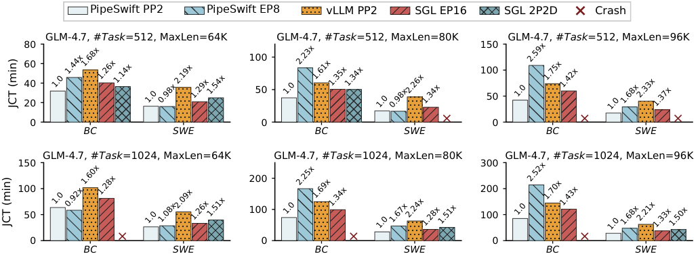
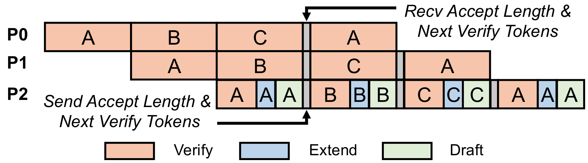

# PipeSwift

**A high-performance, lightweight pipeline-parallel runtime for large-scale
agentic LLM serving on NVIDIA Hopper GPUs for curriculum generation and systems research.**

## Why PipeSwift?

Large MoE and long-context models often need more memory than a single node can
provide. Tensor and expert parallelism distribute individual layers, but do not
remove the per-layer memory pressure or provide the same resource-scaling
flexibility as pipeline parallelism. Pipeline parallelism solves that capacity
problem, yet a conventional implementation can lose much of the benefit to
pipeline bubbles, CPU scheduling overhead, and imbalanced decode micro-batches.

PipeSwift is built around a pipeline-first runtime that addresses those costs:

- **Asynchronous pipeline execution** keeps stages progressing independently.
- **Scheduler overlap** pipelines control-plane work with GPU execution.
- **Length-aware zigzag decode scheduling** balances heterogeneous sequences
  across pipeline micro-batches.
- **MTP integration across pipeline stages** carries verification, accepted-token
  feedback, and the next draft tokens through the pipeline without turning MTP
  into a separate serving path.
- Chunked prefill, paged KV cache, prefix caching, and optional CPU L2 KV cache
  make long-context experiments practical.

The codebase is intentionally compact. Researchers can change the scheduler,
parallel layout, cache policy, or speculative-decoding path without working
through a large production serving stack.

## Performance

The figure below reports end-to-end job completion time (JCT; lower is better)
for representative GLM-4.7 agentic traces. Values above bars are normalized to
PipeSwift PP2 in each workload.



PipeSwift also integrates MTP directly into the pipeline. The last stage returns
the accepted length and next verification tokens while earlier stages continue
to advance pipeline work.



## Features

### Pipeline runtime

- **SPMD architecture with distributed scheduler for flexible implementation**
- **Scheduler/GPU execution overlap to hide CPU overhead**
- **Zigzag decode micro-batching partitioning for balanced decode workload**
- **Pipeline-aware MTP speculative decoding**
- **PD Orchestration Scheduling for Agentic Workloads**

### Models and parallelism

- Llama 2/3, Qwen 3 and Qwen 3 Coder, DeepSeek V3, and GLM 4-family models
- MHA, GQA, MLA, dense FFN, and MoE architectures
- Tensor (TP), pipeline (PP), expert (EP), and decode-context (DCP) parallelism

### Basic Techniques

- Paged attention, chunked prefill, and prefix caching
- FP8 weight quantization (per channel & per block)
- FP8 E4M3 KV Cache Quantization
- DRAM L2 KV Cache for agentic serving
- MTP speculative decoding for large-scale MoE

### Serving

- OpenAI-compatible `/v1/chat/completions` and `/v1/completions` endpoints
- Native `/generate`, `/health`, and `/v1/models` endpoints
- Non-streaming generation with multi-completion requests
- Tool-call parsing for supported model families

## Build

Clone the repository, create a clean environment, and run the build script:

```bash
git clone <repository-url> PipeSwift
cd PipeSwift

conda create -n pipeswift python=3.12 -y
conda activate pipeswift
bash scripts/build.sh
```

Useful build controls:

```bash
# Keep an existing CUDA/compiler toolchain instead of installing it with Conda.
PIPESWIFT_INSTALL_TOOLCHAIN=0 bash scripts/build.sh

# Use a private or gated model after configuring your own credentials.
export HF_TOKEN=<your-token>
```

To verify the command-line entry point after installation:

```bash
pipeswift --help
```

## Launch A Server

Run the launcher only on the first node. PipeSwift starts workers on the remaining
nodes over passwordless SSH:

```bash
export PIPESWIFT_CONDA_ENV=pipeswift
export PIPESWIFT_REMOTE_LAUNCH_TIMEOUT=600

pipeswift \
  --host 0.0.0.0 \
  --port 8000 \
  --model glm4 \
  --weight_path /shared/models/GLM-4-FP8 \
  --quant_type fp8_per_block \
  --fp8_gemm_backend deep_gemm \
  --tp 8 \
  --ep 8 \
  --pp 2 \
  --ip_addrs 10.0.0.10,10.0.0.11 \
  --master_port 7777 \
  --use_zigzag_schedule_decode \
  --max_context_len 200000 \
  --max_batched_tokens 4096 \
  --max_batchsize 128
```

The first address must be the launch node's concrete address. All nodes need the
same absolute repository, environment, and model paths. Install `pdsh`, enable
passwordless SSH, and allow the master port plus TCP ports 3678 and 8888 between
nodes. `PIPESWIFT_CONDA_ENV` defaults to the active Conda environment and falls
back to `pipeswift`.

## Send Requests

```bash
curl http://127.0.0.1:8000/v1/chat/completions \
  -H 'Content-Type: application/json' \
  -d '{
    "model": "qwen3",
    "messages": [{"role": "user", "content": "Explain pipeline parallelism."}],
    "max_tokens": 256,
    "temperature": 0.7
  }'
```

Check readiness with:

```bash
curl http://127.0.0.1:8000/health
```

## Offline Example

The repository includes a small AIME driver for validating a local checkpoint:

```bash
python test_offline.py \
  --model qwen3 \
  --weight_path /models/Qwen3 \
  --tp 8 \
  --n_sample 4 \
  --max_gen_tokens 256
```

## Important Options

| Option | Meaning |
| --- | --- |
| `--tp`, `--pp`, `--ep`, `--dcp` | Tensor, pipeline, expert, and decode-context parallel degrees |
| `--max_batched_tokens` | Maximum tokens in one scheduled batch |
| `--max_batchsize` | Maximum sequences admitted by the runtime |
| `--use_zigzag_schedule_decode` | Balance PP decode micro-batches by context length |
| `--disable_overlap_schedule` | Disable scheduler/GPU overlap; required for MTP today |
| `--num_spec_tokens` | Number of MTP draft tokens; `0` disables MTP |
| `--enable_fp8_dispatch` | Use FP8 expert dispatch with blockwise-FP8 MoE |
| `--enable_fp8_kv` | Store MHA/GQA KV cache as FP8 E4M3 |
| `--l2_cache_gb` | CPU L2 KV-cache capacity per rank in GiB |
| `--enforce_eager` | Disable CUDA Graph execution for low-batch decode |

Run `pipeswift --help` for the complete option list.

## Repository Layout

```text
pipeswift/engine/       Scheduler, pipeline runtime, and KV-cache management
pipeswift/llms/         Model definitions and MTP implementation
pipeswift/server/       OpenAI-compatible HTTP server
pipeswift/utils/        Parallel collectives, kernels, and runtime utilities
csrc/                  Hopper CUDA/CUTLASS kernels
scripts/               Build, validation, and cluster utilities
figs/                  Performance and design figures
```

## Development

Install and run the repository checks before submitting a change:

```bash
python -m compileall -q pipeswift
pre-commit run --all-files
```

Kernel changes should be tested on Hopper with both eager and CUDA Graph paths.
Scheduler changes should cover PP, MTP, prefix-cache hits, and memory-pressure
cases because these paths share page-allocation state.

## Citation

If PipeSwift is useful in your research, please cite PipeSwift:

```bibtex
@article{wang2026pipeswift,
  title={PipeSwift: Revisiting Pipeline Parallelism for Large-Scale Completion-Oriented Agentic Serving},
  author={Wang, Shiju and Ren, Fei and Fu, Fangcheng and Tan, Zhanhong and Li, Kairui and Cai, Jingwei and Ma, Kaisheng},
  journal={arXiv preprint arXiv:2609.16491},
  year={2026}
}
```
